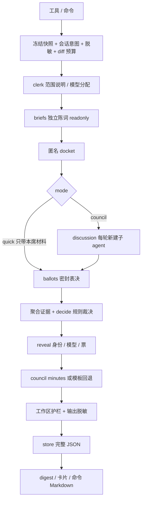

# 实现说明（0.1.0）

依据 [DSH 原生设计 v1.1](superpowers/specs/2026-10-18-magi-review-dsh-native-design-zh.md)，以当前源码为实现事实。兼容基线 DSH 0.2.1-rc.2；配置和用法见 [README](../README.md)，威胁边界见 [安全说明](security.md)。

## 模块地图与数据流

| 模块 | 职责 |
|---|---|
| `lib/index.js` | 注册工具/命令；绑定调用来源；保存卡片投影；处理报告查询；挂载子 agent 创建时的权限兜底。 |
| `lib/client.js` | 宿主 `tool.call.toolview` 中的 `magi_review` 卡片，匿名占位与最终揭示态。 |
| `cordis.patch.yml` / `lib/restrict.js` | Host row、两套 reviewer preset；按 wire tool name 执行白名单 guard。 |
| `lib/host/config.js` | 默认值、可信配置校验、模型目录约束、pin 与同构判定。 |
| `lib/host/git.js` / `session-context.js` | 只读 Git/turn/patch 快照、哈希、覆盖率；最近用户意图与交付声称。 |
| `lib/host/orchestrator.js` | 参数、来源、路由、脱敏、diff 预算、clerk、引擎、工作区护栏、存储；构造卡片与命令 Markdown。 |
| `lib/host/clerk.js` / `llm-json.js` | 会前范围说明与模型分配；流式文本聚合、JSON 调用/校验、目录及默认路由解析。 |
| `lib/host/prompts.js` / `protocol.js` | nonce 数据分区、阶段提示、JSON 字段白名单、seatRef/round 绑定与纪要约束。 |
| `lib/host/seat.js` | 一次 activation 的创建、结果等待、超时、取消、dispose；迟到 activation 也清理。 |
| `lib/host/council.js` / `quick.js` | 阶段调度、重试、匿名材料、讨论终止、密封收票、规则裁决、揭示、纪要和估算 usage。quick 复用引擎并跳过讨论/纪要。 |
| `lib/host/guard.js` / `store.js` / `errors.js` | 工作区指纹比较；不可变 JSON 报告及可重建索引；阶段错误转换。 |
| `lib/core/*` | diff、指纹、证据聚合、裁决、风险、匿名、脱敏、摘要、模板纪要等纯逻辑。 |

quick 在 reveal 后直接进入护栏和存储；失败阶段的处理见下表。工具传 `args.__invokedAs='tool'` 和 `deps.invokedAs='tool'`；命令传 `deps.invokedAs='command'`。`runReview` 优先读 args 来源，再读 deps；来源不是公开参数，不由模型选择。

## 关键决策与理由

1. **纯 ESM、零 bare import。** `lib/` 同时是源码与交付文件，用运行时校验表达契约；只静态导入相对模块与 `node:` 内置模块。这样本地 bundle 位于 app.asar 外时，不依赖 DSH npm 包的解析链。Client 通过 `window.__ModuleLoader__` 获取宿主 React。
2. **每个阶段一次性子 agent。** DSH 的 `sendMessage` 在旧子 agent settle/dispose 后会冷恢复，默认父通知可能泄露票与立场。当前每席陈词、每轮讨论、最终表决均单独 `startActivation`，`delivery:'caller'`，收结果后 dispose。使用设计 §4.4 允许的降级路径，代价是重复上下文和更高延迟。
3. **表决用 readonly preset，再禁全部工具。** readonly 本身仍有 read/grep/glob；`index.js` 在工具 dispatch 时读取持久化 descriptor label，`magi-ballot-*` 或未绑定阶段时拒绝全部工具，包括 `structured_output`。票通过文本 JSON 提交，不能只靠 persona 声称“只读”。
4. **匿名 docket 从白名单重建。** `core/anonymity.js` 逐层挑选 findings/location/evidence 字段，并清洗已知身份；`council.js` 再净化配置中的真实席位、视角、provider/model。公开 digest 和卡片受 reveal 闸门约束，票收齐后才裁决；平台 catalog 可见性不在此边界内。
5. **preset + Host guard 兜底。** preset 控制注册工具；`restrict.js` 在 dispatch 前 deny-by-default，避免父级后来注册的工具穿透。Host 的 `agent/created` 钩子补装 guard，支持符合条件的恢复会话；组合阶段模块加载失败仍会导致启动失败，guard 无法修复。
6. **文件存储。** 避免 storageDomain/zod 的运行时包导入。`store.js` 先写同目录临时文件，再以 hard link 原子发布不可变报告，已存在的 reportId 不覆盖；可变索引/cache 通过 rename 更新。进程内写队列串行，索引可扫描报告重建；跨进程 cache 更新仍未协调。
7. **Git 使用 `node:child_process.execFile`。** 用参数数组执行只读命令，避免依赖尚未稳定的 `ctx.subprocess` 调用形态及 shell 字符串拼接。差异读取关闭 ext-diff/textconv，记录 OID/patchHash 和未跟踪文件原字节摘要。讨论中的 shell 则仍走 DSH 工具与父会话权限。
8. **双输出通道。** 模型文本走小摘要；卡片走 `presentationMeta` 的白名单 JSON。DSH 深拷贝会破坏对象身份，入口按 reportId 缓存投影（最多 128 项），full 结果还可自行重建投影。UI 无中间 projection，因此运行中只显示匿名占位。

## 与设计的偏差、原因及补齐方向

| 设计目标 / 当前实现 | 为什么 | 未来如何补 |
|---|---|---|
| TS + src/构建目录 → 纯 JS ESM + lib/ | 零构建、零运行时包解析风险；已有协议运行时校验。 | 需要静态契约时先增强 JSDoc/独立类型检查，保持 bundle 无运行时依赖。 |
| 同席连续讨论/表决 → 每阶段新子 agent，文本 JSON 最多重试一次 | 冷恢复的父通知无法可靠维持秘密表决。 | 平台支持持久化 caller delivery 和稳定续聊结果通道后，再验证复用；保留一次性回退。 |
| 书记官选范围 → Host 先冻结范围，clerk 解释且不得扩张 | 显式参数、快照哈希和脱敏预算需要确定输入。 | 增加“候选范围提案 → 校验 → 冻结”的独立流程，确保模型不能扩大可信权限。 |
| 按视角裁剪完整文件上下文 → 各席同一份按文件边界裁剪的 diff，视角由提示区分 | 保证共同证据基础，先解决大工作区超时和覆盖记录。 | 增加可审计的 context manifest、文件包/分批计划及覆盖合并。 |
| 原设计 brief/round/ballot/total 为 120/90/30/600 秒 → 240/180/60/1800 秒；diff 预算 16000 tokens | 既有真实运行暴露超时，M2d 已调整默认值。 | 建立 3/5/7 席成本与时延基线后再调参。 |
| 人工确认统一默认 300 秒 → orchestrator 未显式配置时 120 秒；仅命令询问 | 工具路径无法可靠获取人工回答，等待拖延评审。config.js 尚保留旧 300 秒默认。 | 统一归一化与编排默认值；平台具备稳定交互后重新评估工具询问。 |
| DSH 全局容量超限排队 → 本地按 concurrency 分批，启动失败按单席错误处理 | 没有接入共享子 agent 容量队列。 | 增加有总截止时间的容量重试/等待，不泄露各席状态。 |
| 不可达模型自动切换默认路由 → 分配时可回退；执行失败目前重试同一路由 | 目录可见不代表凭据/额度有效；`turn()` 未实现跨路由重选。 | 实现受 provider 策略约束的一次换路由重试，记录实际模型与 `model_fallback`，做真实异构验收。 |
| 表决失败沿用最后有效讨论立场 → 当前回退首轮 brief | DiscussionResponse 没有完整最终 verdict/findings 替换协议，无法可靠重建最终立场。 | 增加受绑定和校验的立场快照，失败时沿用最近一份，并测试新增发现不被遗漏。 |
| storageDomain/profile 隔离 → 文件 JSON，环境变量决定 namespace，通常为 default | 避免 bare import；入口没有可靠 profile 名来源。 | 通过稳定运行时 profile API 注入 store root；增加迁移/保留策略。 |
| 缓存命中直接复用 → store 有 cache API，但 orchestrator 不读写缓存 | 主流程尚未接入完整版本化缓存键。 | 接入 snapshot/模型/席位/policy/prompt 版本键及跨进程协调，再开放缓存命中声明。 |
| 完整 JSON 命令导出/目录导出 → `--report` 返回 ≤20 KiB Markdown，JSON 从磁盘读取 | 目前命令只接渲染函数，`exportMarkdownDir` 尚无写出逻辑。 | 明确定义导出格式与目标路径权限，再新增独立导出能力。 |
| 实时匿名进度 → 运行中匿名占位 | 工具结果只在完成时提供卡片数据，未注册中间 projection。 | 加只含阶段/匿名状态的查询或投影，测试不能泄票。 |
| 精确 usage/美元预算 → 字符数估算，缺少完整 provider usage/价格 | seat 适配层不透传可靠 token/价格；美元阈值只能消费已有数据。 | 透传真实 usage/价格，含 clerk/minutes/重试费用，增加硬预算和成本基准。 |
| 全过程平台级匿名 → 插件数据面匿名，平台子会话仍可被发现 | DSH catalog/session log 可见性不是 bundle 可控制的权限。 | 平台增加私有子会话/延迟公开；届时验证 catalog、侧栏和通知链。 |
| 所有入模数据脱敏 → Host 扫描自己组装的数据与返回结果 | 审查者通过 read/shell 直接读取的内容仍走 DSH，不经过 Host 扫描器。 | 平台增加工具结果脱敏/秘密路径策略；扩展规则与漏检测试。 |
| 首次第三方外发提示、工作区配置 provenance、匿名开关 → 尚未接入；主流程固定裁决后揭示 | 当前只消费可信 profile 配置；未构建设置 UI/工作区配置入口。 | 增加明确的数据流提示与 provenance；配置开关必须与实际隔离能力一致。 |
| 每阶段完整证据会话引用 → 最终公开结果主要保留 brief childSessionId | 讨论/表决适配返回 childId，但引擎未把它们全部持久化进审计索引。 | 裁决后保存全部阶段会话定位，依旧不在中途暴露。 |
| 同步 session API → 仍使用已废弃的 snapshotEvents 等，并有 deriveMessages 兜底 | 当前兼容版本与既有模块契约要求；长会话已补回溯边界。 | 迁移到异步事件读取 API，并覆盖长会话/重启恢复。 |

`anonymity.revealInReport`、`anonymity.auditLedger`、`execution.cache`、`models.fallbackOnError` 等配置的存在不代表完整设计能力已接通。5/7 席若未显式配置额外视角，自动补 general；目前也没有专门的席数成本告警。

## 失败降级矩阵与实现位置

| 触发点 | 当前处理与结果影响 | 实现位置 |
|---|---|---|
| 非法参数/配置、无差异 | 返回 `ok:false`；无差异为 `NO_CHANGES`，不调用 reviewer。 | `orchestrator.js: validateArgs/runReview`，`config.js: validateConfig` |
| turn 不可用、读取失败或内容不全 | 缺服务/事件或快照 error 时回退工作区；空不可用快照可能返回 NO_CHANGES；缺文件标 partial。 | `orchestrator.js: runReview`，`git.js: turnSnapshot/snapshotReview` |
| 输入脱敏失败 | `REDACTION_FAILED`，停止且不调用模型。 | `orchestrator.js: redact/runReview` |
| 书记官调用/JSON 无效 | 使用冻结范围和确定性模型分配，`clerk_fallback`，有效证据仍可裁决。 | `clerk.js: runClerk`，`orchestrator.js: runReview` |
| 单席陈词失败、非法响应、超时 | 最多两次尝试且受总截止时间约束；该席 error，其余继续；`reviewer_error:<seatRef>`，可能不足 quorum。 | `council.js: turn/briefs`，`seat.js: runSeatTurn`，`protocol.js` |
| 单席讨论失败 | 缺失回应不证明稳定；保留已有材料，记录 `discussion_missing:<seatRef>`，仍尝试最终表决。 | `council.js: discussion/previous/latest` |
| 轮次到顶且人工回答缺失 | 工具直接表决；命令限时询问，缺失则 `human_confirmation_missing`；继续只追加有限轮次。 | `council.js: askHuman/round_cap`，入口来源由 `index.js` 绑定 |
| 单席表决失败 | 使用该席 brief 的票与 findings，记录 `ballot_missing:<seatRef>`。 | `council.js: ballots` |
| 重复/伪造票、全部席位失败 | 重复票使该席失效；全部无效为 `none/error/untrustworthy`，不伪造 quorum。 | `core/policy.js: decideWithPolicy`，`protocol.js: bindSeat` |
| partial/取消/预算用尽 | 停止后续工作，保留已完成证据；partial/interrupted 禁止 approve；前置阶段取消可能直接返回错误。 | `prompts.js: budgetSnapshot`，`council.js: stopped/reserveInput`，`core/policy.js` |
| 纪要失败/越权/非法 JSON | 模板纪要，`minutes_failed` 或 `minutes_invalid`；不改变规则 verdict。非法输出只留有界校验诊断，不存原始回复。 | `council.js: minutesCause/纪要阶段`，`protocol.js: validateMinutes`，`core/minutes-template.js` |
| 评审中工作区变动 | `workspace_mutated_during_review`；降级且把原 approve 改为 insufficient。指纹不可得则 `workspace_guard_unavailable`。 | `guard.js`，`orchestrator.js: degradeResult` |
| 席位/纪要/最终结果脱敏失败 | 席位输出扫描失败中止后续模型工作；最终结果扫描失败不返回/存储该报告。 | `council.js: scrub`，`orchestrator.js: 输出 redact` |
| 存储失败 | 保留内存结果，`storage_failed` + `STORAGE_FAILED`；不保证 reportId 可检索。 | `store.js: saveReview`，`orchestrator.js: store/degradeResult` |

错误与叙事不是指令；失败不授权扩权或执行 findings 内的命令。覆盖这些行为的自动测试和历史运行结果见 [验证记录](verification.md)。
